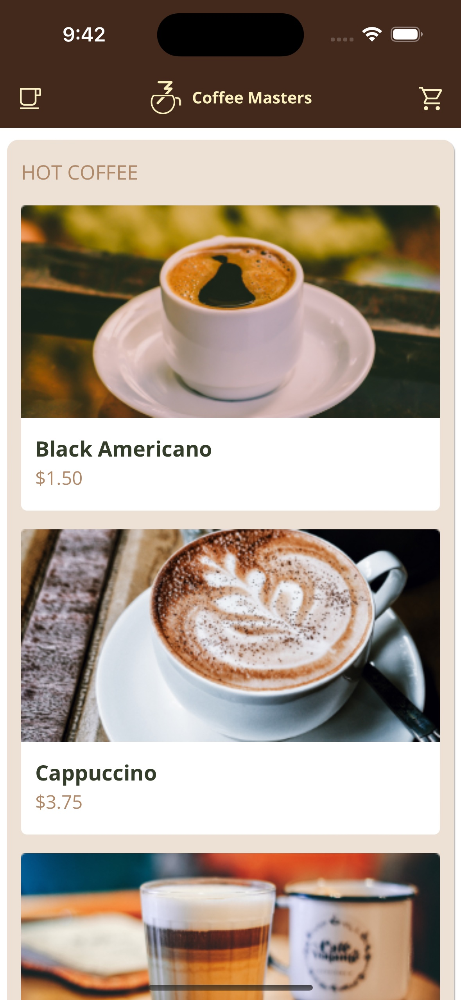
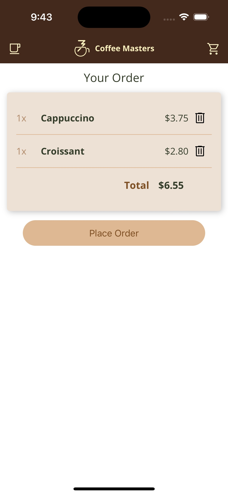

# Coffee Masters

A small coffee shop ordering app built with plain JavaScript — no framework, no build step, no dependencies. It shows how far modern browser APIs go on their own: Web Components with Shadow DOM, a client-side router on the History API, and a reactive store built on a `Proxy`.

Users browse a menu, open product details, add items to a cart and fill in an order form. The menu is loaded from a static JSON file, so there is no backend.

<p>
  
  
</p>

## Features

- **Menu page** — products grouped by category (hot coffee, iced coffee, tea, snacks), rendered from `data/menu.json`.
- **Product details** — `/product/:id` shows the image, description and price, with an "Add to cart" button.
- **Cart and order form** — `/order` lists cart items with quantities and a running total; items can be removed. The form collects name, phone and email.
- **Cart badge** — the header icon shows the number of items in the cart.
- **Client-side routing** — navigation uses `history.pushState`, and back/forward buttons work. Unknown routes show a simple 404 message.
- **Installable as a PWA** — includes a web app manifest with icons and screenshots.

## Tech stack

- HTML, CSS and JavaScript (ES modules)
- Custom Elements, Shadow DOM and `<template>` elements
- History API for routing
- `Proxy`-based state with custom DOM events (`appmenuchange`, `appcartchange`)
- Google Fonts (Open Sans, Material Symbols) loaded from a CDN

## Getting started

### Prerequisites

- A modern browser (Chrome, Edge, Firefox or Safari)
- Any static file server. The examples below use Node.js (for `npx`) or Python 3.

The app must be served over HTTP from the site root. Opening `index.html` directly from disk (`file://`) won't work, because ES modules and `fetch` calls are blocked there, and the code uses absolute paths such as `/data/menu.json`.

### Run locally

```bash
git clone https://github.com/nkelava/coffee-shop-vanillajs.git
cd coffee-shop-vanillajs
```

Then start a server in the project root. The recommended option rewrites unknown paths to `index.html`, so reloading a page like `/order` keeps working:

```bash
npx serve -s .
```

Open the URL it prints (by default http://localhost:3000).

Without Node.js, Python works too:

```bash
python3 -m http.server 8000
```

Open http://localhost:8000. This server has no SPA fallback, so always start from `/` and navigate within the app — reloading on `/order` or `/product/:id` returns a 404 from the server.

There is nothing to install or build, and no environment variables or configuration.

## Usage

| Route          | Page                                                   |
| -------------- | ------------------------------------------------------ |
| `/`            | Menu. Click **Add** to add an item, or a card to open its details. |
| `/product/:id` | Product details, e.g. `/product/12` for the Cappuccino. |
| `/order`       | Cart contents, total and the order form.               |

The app exposes its store and router on `window.app`, which is handy when experimenting from the browser console:

```js
app.store.menu;          // menu loaded from data/menu.json
app.store.cart;          // [{ product, quantity }, ...]
app.router.go("/order"); // navigate programmatically
```

### Editing the menu

Products live in `data/menu.json` as a list of categories, each with its products:

```json
{
  "name": "HOT COFFEE",
  "products": [
    {
      "id": 11,
      "name": "Black Americano",
      "price": 1.5,
      "description": "Freshly pulled shots of espresso combined with hot water.",
      "image": "blackamericano.png"
    }
  ]
}
```

`id` must be unique across all categories, and `image` is a file name inside `data/images/`.

## Project structure

```
coffee-shop-vanillajs/
├── index.html          # App shell: header, <main> outlet and all <template> markup
├── app.js              # Entry point: registers components, sets up window.app, starts the router
├── styles.css          # Global styles
├── app.webmanifest     # PWA manifest (name, colors, icons, screenshots)
├── serviceworker.js    # Service worker stub (handlers not implemented yet)
├── components/         # Web Components; page components load their own CSS into Shadow DOM
│   ├── MenuPage.js / .css      # <menu-page>    – menu grouped by category
│   ├── DetailsPage.js / .css   # <details-page> – single product view
│   ├── OrderPage.js / .css     # <order-page>   – cart, total and order form
│   ├── ProductItem.js          # <product-item> – product card in the menu
│   └── CartItem.js             # <cart-item>    – line item in the cart
├── services/
│   ├── API.js          # Fetches /data/menu.json
│   ├── Store.js        # Proxy-based store; dispatches change events on menu/cart updates
│   ├── Router.js       # History API router mapping paths to page components
│   ├── Menu.js         # loadMenu() and getProductById()
│   └── Order.js        # addToCart() and removeFromCart()
├── data/
│   ├── menu.json       # Menu data
│   └── images/         # Product images
└── images/             # Logo, app icons and screenshots
```

## How it works

1. `app.js` imports the services and components, puts the store and router on `window.app`, and on `DOMContentLoaded` loads the menu and initializes the router.
2. `Router.go(path)` creates the matching page element (`<menu-page>`, `<order-page>` or `<details-page>`) and swaps it into `<main>`.
3. Setting `app.store.menu` or `app.store.cart` goes through the `Proxy`, which dispatches `appmenuchange` or `appcartchange` on `window`. Pages and the cart badge listen for these events and re-render.

## Current limitations

- Placing an order only shows a confirmation alert; nothing is sent to a server.
- `serviceworker.js` contains empty handlers and is not registered, so there is no offline support yet.
- The cart is kept in memory and is cleared on a full page reload.
- Loading `/product/:id` directly as the first page can fail, because `getProductById` may run before the menu has loaded. Navigating there from the menu works.

## Credits

Based on the Coffee Masters app from [Frontend Masters](https://frontendmasters.com/).
